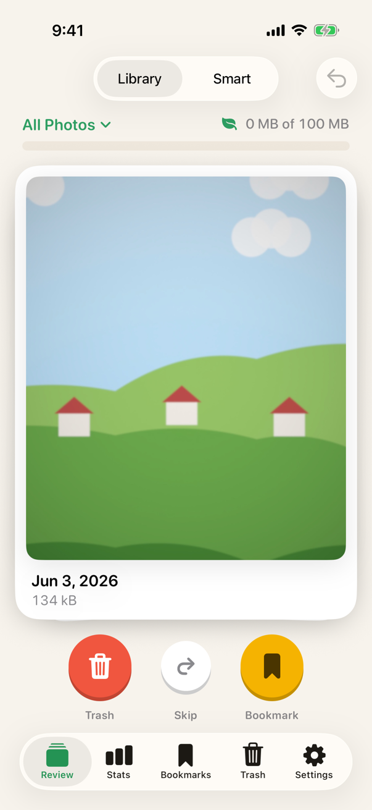
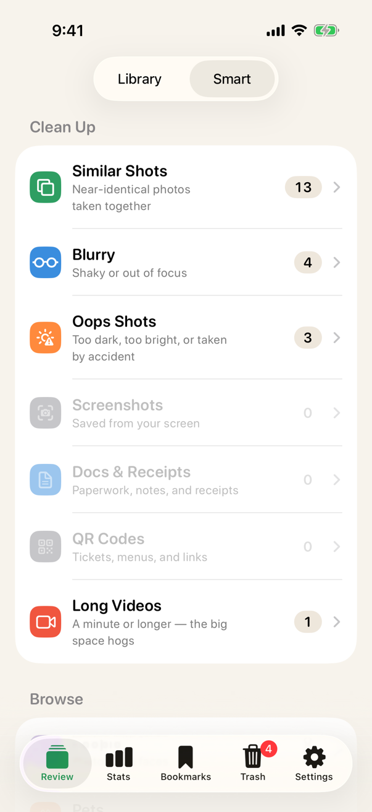
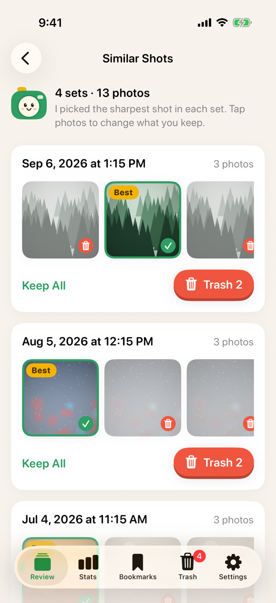
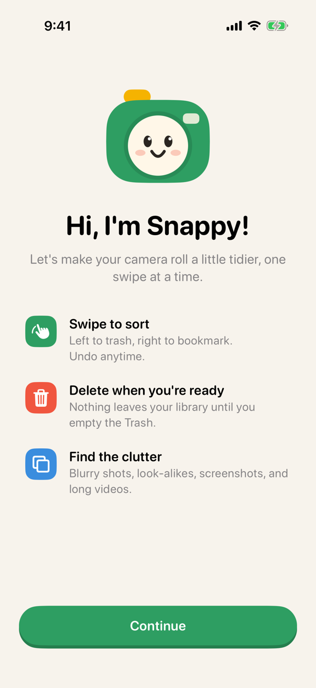
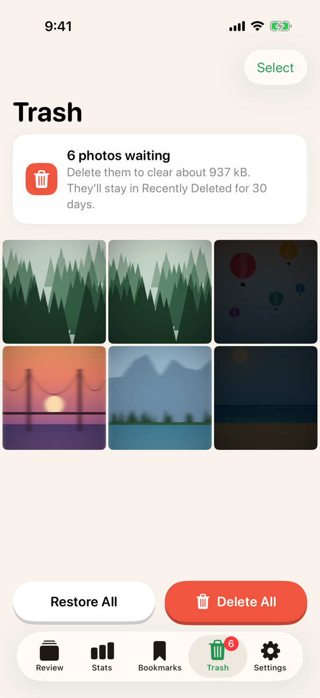
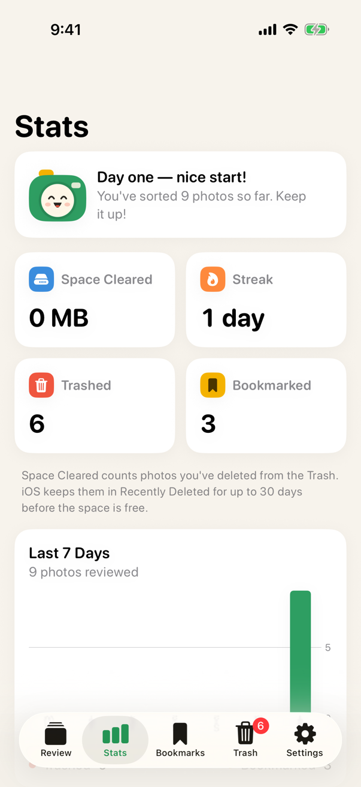
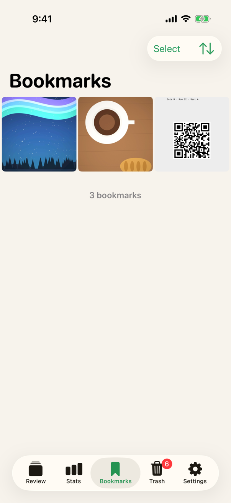
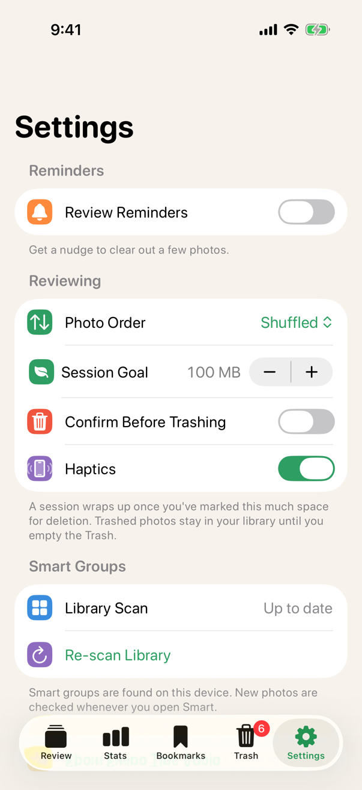
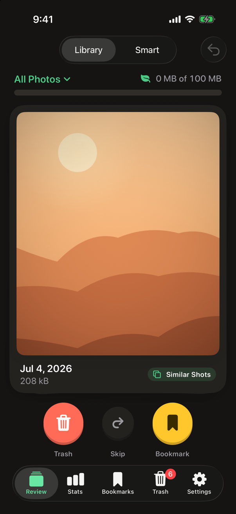

<p align="center">
  
</p>

<h1 align="center">SnapSort</h1>

<p align="center">
  Swipe through your camera roll, keep what matters, and clear out the rest.<br>
  A friendly photo cleaner for iPhone that does all of its work on your device.
</p>

<p align="center">
  
  &nbsp;
  
  &nbsp;
  
</p>

## What it does

**Swipe to sort.** Photos come up one at a time as a stack of polaroids. Swipe left to move one to the Trash, right to bookmark it, or tap Skip to come back to it later. Tap a card to see it full screen, with pinch-to-zoom and video playback. Undo works for several steps.

**Smart groups find the clutter for you.** SnapSort scans your library in the background and sorts it into groups:

| Clean up | | Browse | |
|---|---|---|---|
| **Similar Shots** | Near-identical photos taken together | **People** | Photos with faces |
| **Blurry** | Shaky or out of focus | **Pets** | Furry, feathery, and scaly friends |
| **Oops Shots** | Too dark, too bright, or taken by accident | **Food** | Meals, snacks, and treats |
| **Screenshots** | Saved from your screen | **Scenery** | Landscapes, skies, and cityscapes |
| **Docs & Receipts** | Paperwork, notes, and receipts | | |
| **QR Codes** | Tickets, menus, and links | | |
| **Long Videos** | A minute or longer, the big space hogs | | |

**Similar Shots picks the keeper.** For each burst or retake, SnapSort suggests the best photo based on sharpness, exposure, favorites and resolution. Tap any photo to change what you keep, then trash the rest in one go.

**A Trash you control.** Nothing leaves your library while you sort. Photos wait in SnapSort's Trash until you delete them, all together with a single iOS confirmation. Deleted photos then go to Recently Deleted in the Photos app for 30 days. You can restore any of them, or select several at once.

**Progress you can see.** Stats shows the space you've cleared, your daily streak, a 7-day chart, and milestones as you go. Each session has a goal, and Snappy the camera cheers you on when you reach it.

**And the small things:**
- **Reminders:** daily, weekly or monthly.
- **Widget:** a home screen widget with your streak and stats.
- **Filters:** library filters (Videos, Selfies, Live Photos, Portraits, Favorites and more) plus a year filter.
- **Haptics:** a light click as a card crosses into a swipe zone, and different feels for bookmarking, trashing, undoing and celebrating. You can turn them off in Settings.
- **Looks and layout:** dark mode, and an iPad layout.
- **Accessibility:** VoiceOver actions on every card, keyboard shortcuts (← Trash, → Bookmark, ↓ Skip, ⌘Z Undo), Reduce Motion support, and Dynamic Type.

## Screenshots

| | | |
|:-:|:-:|:-:|
|  |  |  |
| Meet Snappy | Swipe to sort | Smart groups |
|  |  |  |
| Similar Shots | Trash | Stats and milestones |
|  |  |  |
| Bookmarks | Settings | Dark mode |

The photos in these screenshots are original illustrations made for the demo library (see [Screenshots](docs/screenshots.md)).

## Privacy

- **Everything happens on your iPhone.** Photo analysis uses Apple's on-device frameworks, and the results are stored locally.
- **No accounts, analytics, ads, or third-party SDKs.** SnapSort has no server and sends nothing anywhere.
- **The one exception is iCloud Photos.** If your library uses it, iOS may download a full-size original from iCloud when you open a photo, the same as in the Photos app.

## How the smart groups work

| Group | How it's detected |
|---|---|
| Similar Shots | Each photo gets a Vision feature print and a 64-bit difference hash. Photos are compared only with others taken within 5 minutes, so the scan stays fast on large libraries. |
| Blurry | A "re-blur" sharpness measure at 1024 px: a sharp photo changes a lot when blurred, a soft one barely changes. It's combined with Vision's aesthetics score for borderline cases. |
| Oops Shots | Brightness, contrast spread and clipping catch pocket shots and blown-out frames. |
| Screenshots | Photos marked as screenshots by iOS. |
| Docs & Receipts, Pets, Food, Scenery | Vision image classification. |
| QR Codes | Vision barcode detection. |
| People | Vision face detection. |
| Long Videos | Videos of 60 seconds or more. |

Results are cached, so only new photos are analyzed on later launches. The scan also runs as a background task when iOS allows it.

## Requirements

- iOS 18.2 or later. Works on iPhone and iPad.
- Developed with Xcode 27 (beta). Any Xcode with the iOS 18.2 SDK or newer should work.

## Getting started

1. Clone the repo and open `SnapSort.xcodeproj`.
2. Pick your team under **Signing & Capabilities** for the **SnapSort** and **SnapSortWidgetsExtension** targets.
3. Choose an iPhone and run.

The build runs [SwiftLint](https://github.com/realm/SwiftLint) if it's installed (`brew install swiftlint`); otherwise it only prints a reminder.

If you build under your own bundle ID, the app and the widget share stats through an App Group. Change `group.com.canoe.snapsort` in these places:
- `SnapSort/SnapSort.entitlements`
- `SnapSortWidgets/SnapSortWidgetsExtension.entitlements`
- `Constants.AppGroup.identifier` in `SnapSort/Shared/Constants/Constants.swift`

The background scan identifier in `SnapSort/Info.plist` and in `Constants.Analysis` uses the same prefix.

Vision-based groups (Docs & Receipts, QR Codes, People, Pets, Food, Scenery) need a real device, because the Simulator can't run Vision's models. Haptics also only play on a device.

## Tests

Unit tests use Swift Testing and cover:
- image metrics
- similar-shot grouping
- reminder scheduling
- settings
- analytics (streaks, milestones, restores)
- the Trash
- the haptic patterns

Run them in Xcode with ⌘U, or:

```bash
xcodebuild test -project SnapSort.xcodeproj -scheme SnapSort \
  -destination 'platform=iOS Simulator,name=iPhone 17 Pro' \
  -only-testing:SnapSortTests
```

`SnapSortUITests/ScreenshotTests.swift` walks through the app and captures the screenshots above. See [docs/screenshots.md](docs/screenshots.md) for how to run it.

## Project structure

```
SnapSort/
├── App/                 App entry, tabs, deep links
├── Core/
│   ├── Data/            Core Data stack and model
│   ├── Haptics/         Haptic patterns and the Core Haptics engine
│   └── Services/        Photo library, analysis, smart groups, Trash,
│                        bookmarks, analytics, reminders, background tasks
├── Features/
│   ├── PhotoReview/     Swipe deck, smart groups, Similar Shots, people
│   ├── Analytics/       Stats screen and chart
│   ├── Bookmarks/
│   ├── Trash View/
│   ├── Onboarding/
│   └── Settings/        Settings, plus a Haptics Lab in debug builds
├── Shared/              Colors, spacing, models, reusable views (Snappy lives here)
└── Widgets/             Stats widget
SnapSortWidgets/         Widget extension
SnapSortTests/           Unit tests
SnapSortUITests/         UI tests, including the screenshot run
scripts/demo-library/    Generates the demo photo library used for screenshots
```

## Built with

SwiftUI, Core Data, PhotoKit, Vision, Core Image, Core Haptics, Swift Charts, WidgetKit, BackgroundTasks, and AVKit. There are no third-party dependencies.
